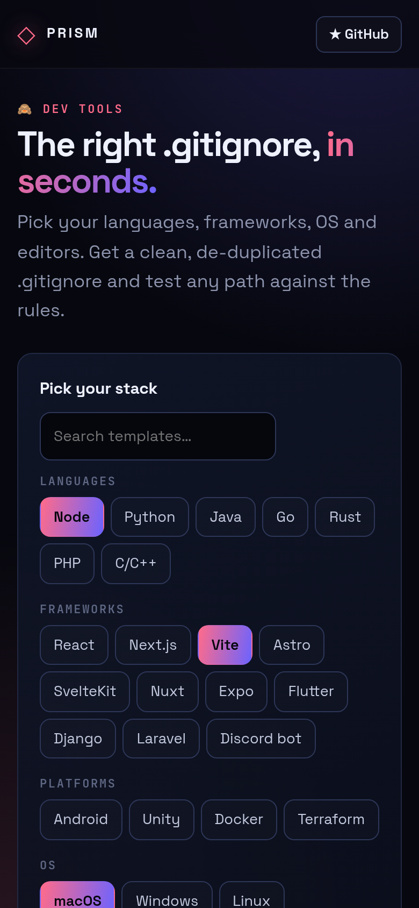

<!-- ═════════════ HEADER ═════════════ -->
<p align="center">
  
</p>

<p align="center">
  
</p>

<p align="center">
  <a href="https://github.com/krishyaa06/prism-gitignore-builder/actions/workflows/ci.yml"></a>
  <a href="https://krishyaa06.github.io/prism-gitignore-builder/"></a>
  
  
  <a href="LICENSE"></a>
</p>

<p align="center">
  
</p>


## ⚡ Overview

**Prism Gitignore Builder** makes a sensible `.gitignore` for any project. Select templates across languages, frameworks, platforms, operating systems and editors, add your own patterns, and download a merged file with duplicates removed. A built-in matcher tells you whether a given path will be ignored and which rule is responsible.

## ✨ Features

- **31 templates**: Node, Python, Go, Rust, Next.js, Vite, Expo, Flutter, Django, Laravel, Unity, Android, Terraform, Discord bots, AI tools and more
- **Smart merge** that removes duplicate rules
- **Custom rules** box
- **Path tester** with negation (`!`), anchors, `*`, `**` and character classes
- Optional section comments, copy or download
- Selections saved locally

## 📸 Screenshots

<table>
  <tr>
    <td width="68%"></td>
    <td width="32%"></td>
  </tr>
</table>

## 🚀 Quick Start

**Use it online:** [https://krishyaa06.github.io/prism-gitignore-builder/](https://krishyaa06.github.io/prism-gitignore-builder/)

**Run locally:**

```bash
git clone https://github.com/krishyaa06/prism-gitignore-builder.git
cd prism-gitignore-builder
# open index.html in your browser, or serve it:
npx serve .
```

## 🛠️ Usage

1. Click the templates that match your stack (search to filter).
2. Add custom patterns if needed.
3. Type a path in **Will this file be ignored?** to verify.
4. **Download** the `.gitignore` into your project root.

## 📁 Project Structure

```
prism-gitignore-builder/
├── assets/
│   ├── logo.png
│   └── logo.svg
├── css/
│   ├── app.css
│   └── prism.css
├── js/
│   ├── app.js   # UI wiring
│   ├── core.js   # templates, merge and gitignore matcher — tested in Node
│   └── prism.js
├── test/
│   └── core.test.js
├── .gitignore
├── LICENSE
├── index.html
└── package.json
```

## 🧪 Tests

```bash
npm test
```

Tests use the built-in `node:test` runner, so there is nothing to install. CI runs them on Node 20 and 22.

## 🤝 Contributing

1. Fork the repo and create a branch: `git checkout -b feature/my-idea`
2. Make your change and add a test in `test/`
3. Run `npm test` and open a Pull Request

## 🔷 Part of Prism Protocol

Prism Gitignore Builder is one of the open-source tools built by [Prism Protocol](https://dc.gg/prismprotocol), a tech community where young builders learn, ship and compete together.

## 👤 Author

<table>
  <tr>
    <td align="center">
      <a href="https://github.com/krishyaa06"><br><b>Soumya Bhandare</b></a><br>
      <sub>Founder @ Prism Protocol</sub>
    </td>
    <td>
      <a href="https://dc.gg/prismprotocol"></a><br>
      <a href="https://instagram.com/prism_protocol_"></a><br>
      <a href="https://x.com/krishyaa06"></a>
    </td>
  </tr>
</table>

## 📄 License

Released under the [MIT License](LICENSE).

<p align="center">
  <b>If you like this project, consider giving it a ⭐</b><br>
  <sub>"Build. Create. Compete." · Made with ⚡ by Prism Protocol</sub>
</p>


